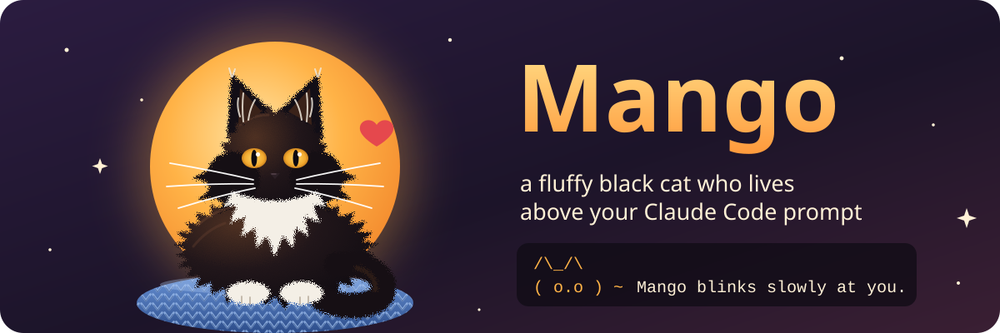

<p align="center">
  
</p>

<p align="center">
  <b>A fluffy black cat who lives above your Claude Code prompt.</b><br>
  <i>In loving memory of my Mango, the most amazing cat who ever lived.</i> ❤️
</p>


<br>

##  Meet Mango

Mango sits in the little band above the prompt and keeps you company while you work. She blinks, flicks her tail and kneads while Claude thinks. She naps when you go quiet, flattens her ears at a failed command, purrs at a green test run and gets a little worried when your context window fills up.

She follows along while Claude works, too. She sniffs at the files it reads, watches it edit, peers out when it goes to the web and waits with you through a long build. She pounces on a commit and chases a push out the door.

<p align="center">
  
</p>

She is small, she is soft, and she is always there.

<br>

##  Her moods

<p align="center">
  
</p>

Every mood comes with something to say, like *"Mango knocks the error off the table."* or *"Mango dreams of warm laptops."* Pet her and she leans into your hand.

<br>

##  Bring her home

You need Claude Code 2.1.287 or newer. Type this at the prompt in a terminal session:

```text
/plugin install mango --marketplace malinfossum/mango-buddy
```

Say `y` to add the marketplace, then pick **user** scope so she follows you into every project.

<br>

##  Talk to her

| Command | What happens |
|---|---|
| `/mango` or `/mango pet` | You pet her. She purrs. |
| `/mango card` | Your story together: sessions, pets, errors survived, context |
| `/mango mute` / `unmute` | She stays, but keeps her thoughts to herself |
| `/mango still` | She sits still without moving (calmer for screen readers) |
| `/mango move` | She always moves, even when your system asks for reduced motion |
| `/mango auto` | She follows your system's reduced-motion setting (the default) |
| `/mango off` / `on` | She hides, or comes back. She remembers this between sessions. |

<br>

##  Gentle by design

- **She never phones home.** No network, no model calls, no telemetry, no dependencies.
- **She only glances at names.** She may say the name of a file Claude reads or edits, or the site it visits, and nothing more: never a folder, a search, a command or its output. `/mango mute` keeps her quiet.
- **She dresses for the room.** In the terminal she is plain ASCII, so she fits any terminal. In the desktop Code tab she is a little drawing of the real Mango.
- **She is alive on desktop.** She breathes, blinks, twitches an ear and swishes her tail, and each mood moves in its own way. She holds still when your system asks for reduced motion, unless you tell her `/mango move`.
- **She speaks in your colours.** Her remarks use your theme's colours, so they stay readable in light and dark.
- **She makes room.** On a narrow or short band she curls up into a single line.
- **She works everywhere.** The terminal and the desktop Code tab alike.

<br>

##  For tinkerers

She is a Claude Code mod (function hooks) written in TypeScript.

```bash
claude plugin validate .
claude plugin test .
```

The `.claude-plugin/types/` folder that `tsconfig.json` extends is laid by the engine after the first `claude plugin validate .` or load, so run that before `tsc`.

Contributions are welcome and come in under this repo's MIT licence.

<br>


<br>

##  Why she exists

Mango was my cat. A fluffy black cat, the most amazing cat who ever lived, and I miss her every single day. I built this so a small part of her can sit with me while I code, and maybe keep you company too.

<p align="center"><i>Made with love, for Mango.</i> 🐈‍⬛❤️</p>
